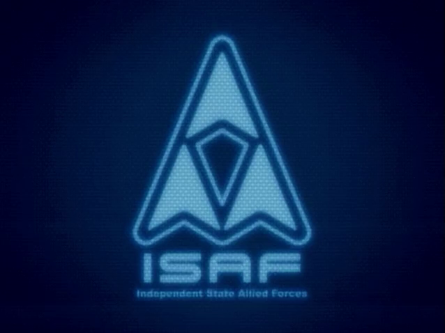

# ISAF T.C. System · dsh-theme-isaf

> 冷静、科幻、CRT 质感的 DeepSeek Harness 双模主题。
> 深蓝半透明 HUD 面板，ISAF 三角徽章壁纸，启动动画与轻扫描线。



## 特性

- **双模深蓝 HUD**：light 是昼间深蓝 `#0b1a2c`，dark 是夜间深蓝 `#050b16`。
  两套都使用蓝白文字与半透明面板，不是「浅色纸面 + 深色反色」。
- **三种强调色**：ISAF 蓝 / 磷光青 / 警示琥珀，可在「设置 → 通用 → 强调色」切换。
- **壁纸舱**：2560×1440 的 ISAF 徽章壁纸铺在 `html` 上，应用四周保留 12px 壁纸边框，
  主面板、侧栏、聊天区用 `color-mix` 半透明玻璃层让徽章透出。
- **直角 HUD**：主面板、侧栏、按钮均为直角；72px 网格 + 4px 周期轻扫描线 + 轻暗角。
- **启动动画**：自带 `assets/startup.mp4`（H.264 / 638×478 / 5.53s）。
  与 `dsh-boot-video` 联动时完整播放；没有 boot-video 时用 `startup-poster.png` 做首帧封面。
- **无 backdrop-filter**：面板只用半透明底色。Chrome 在透明祖先链下会把 backdrop
  采样成黑色，壁纸会被整片遮掉；这是本主题刻意避开的坑。

## 安装

需要 DSH `>=0.2.1-rc.2 <0.3.0`、Node.js `>=20`。

### 方式一：从 tgz 安装

```powershell
dsh plugin --profile web add <path-to>\dsh-theme-isaf-0.1.6.tgz
```

### 方式二：开发期直接链目录

```powershell
git clone <repo-url> dsh-theme-isaf
cd dsh-theme-isaf
dsh plugin --profile web add link:$(Get-Location)
```

安装后刷新页面；**宿主半新增的资源路由与启动注入需要重启一次 DSH GUI 才生效**。
用下面的命令确认已加载：

```powershell
dsh plugin --profile web list
```

## 启动画面与 dsh-boot-video

主题不依赖 `dsh-boot-video`，但两者可以自动联动：

1. 页面加载后检查 boot-video 是否已安装；
2. 如果 `dsh-boot-video:asset` 为空，把主题内的 `startup.mp4` 通过
   `POST /dsh-boot-video/import` 导入为固定素材 `u-isaf-boot`；
3. 只在 `dsh-boot-video:source` / `asset` 为 `null` 时补默认值，
   **不覆盖**用户已经选择的素材或「关闭」状态；
4. 宿主半检测到 profile 已有 `assets/user/u-isaf-boot.mp4` 时，才会注入默认值脚本；
5. 没有 boot-video，或用户关闭了开机动画：`BOOT_CSS` 使用 `startup-poster.png`
   做静态首帧，不会退回默认 HARNESS 字标。

当前 0.1.6 的启动 MP4 就是新的 ISAF 预简报视频，约 5.53 秒，包含音轨；
播放结束后自动淡出，点击或 Esc 可跳过。

## 目录

```
dsh-theme-isaf/
├─ package.json        # DSH bundle / client 清单
├─ cordis.patch.yml    # Loader 行：id theme-isaf，name dsh-theme-isaf
├─ index.js            # 宿主半：首帧 CSS、启动默认值、/theme-isaf/assets 路由
├─ client.js           # 浏览器半：28+6 token、HUD 外壳、CRT、设置行
├─ assets/
│  ├─ startup.mp4      # 启动动画（H.264 + AAC，638×478）
│  ├─ startup-poster.png
│  └─ wallpaper.png    # 2560×1440 ISAF 壁纸
├─ scripts/
│  └─ smoke.mjs        # 无浏览器自检
└─ README.md
```

## 自检

不需要安装到 profile，也不需要浏览器：

```powershell
node scripts/smoke.mjs
```

输出应包含：

- 23 项 bundle / host 契约断言；
- 30 项 WCAG 对比度断言（3 个强调色 × light/dark × 5 个前景/背景组合）；
- 最后一行 `全部通过。`。

当前主文字对比度：

| 模式 | 主文本 | 次级 | 三级 | 说明文字 | 品牌色上的文字 |
| --- | ---: | ---: | ---: | ---: | ---: |
| ISAF light | 14.49 | 10.94 | 8.46 | 6.97 | 5.38 |
| ISAF dark | 15.64 | 11.25 | 8.27 | 6.58 | 8.95 |

## 定制

| 想改什么 | 改哪里 |
| --- | --- |
| 中性色 token | `client.js` 的 `NEUTRAL_TOKENS` |
| 强调色 | `client.js` 的 `ACCENTS`、`ACCENT_LABEL_KEYS`、`MESSAGES` |
| 设置行外观 | `client.js` 的 `AccentRow` 与 `CSS` |
| HUD 外壳 / 壁纸 | `client.js` 的 `SHELL_CSS` + `assets/wallpaper.png` |
| 启动画面 | `index.js` 的 `BOOT_CSS` + `assets/startup-poster.png` + `assets/startup.mp4` |
| 启动视频素材 | 同时更新 `client.js` 的 `BOOT_VIDEO_FIXED_ASSET` 与 boot-video 的 user 素材 |

改完先跑 `node scripts/smoke.mjs`，再刷新 GUI 或重启宿主。

## 设计与边界

- `overrideTokens` 的每个 token 必须同时给 `light` 和 `dark`，它是覆盖层，不是单模式补丁。
- 浏览器半只 `require('react')`；不额外耦合官方 UI 包。
- 三处 id 必须一致：`package.json` 的 `name`、`cordis.patch.yml` 的 `id` / `name`、
  `client.js` / `index.js` 的 `PACKAGE_ID` / `ENTRY_ID`。
- 不要往 `#root > [data-dsh-boot]` 里塞节点：DSH 会在 React 挂载时
  `hydrateRoot` + `dangerouslySetInnerHTML` 复用 boot DOM。启动画面只做 CSS 换皮。
- `/plugins/<pkg>/assets` 的媒体白名单不含 mp4，因此主题自建
  `/theme-isaf/assets` 前缀路由；新增资源要同步加入 `index.js` 的 `ASSETS`。
- 真实 GUI 的视觉效果（启动视频、窗口尺寸下的网格、壁纸透明度）仍需装进 profile 后目测；
  自检覆盖的是契约与对比度，不替代视觉验收。
- 本主题是非官方粉丝作品；ISAF / ACE COMBAT 相关名称与图像版权归其权利人所有，
  仓库不附带对这些素材的再许可。

## 版本

当前 `0.1.6`：启动动画替换为 `theme_assets/isaf_prebriefing.mp4`，
新增 `startup-poster.png` 作为 boot-video 缺席时的首帧封面。
